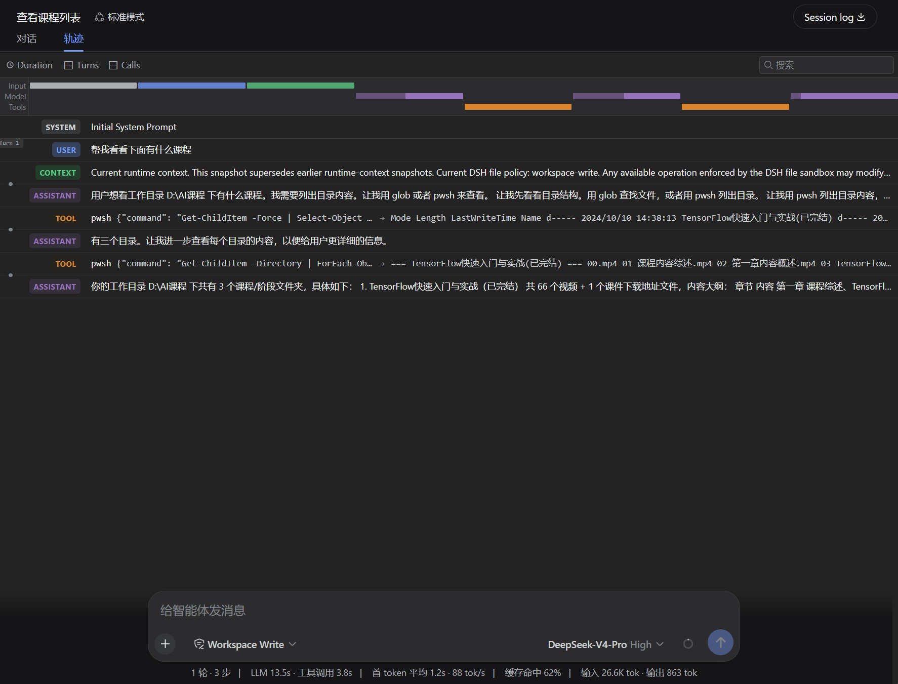
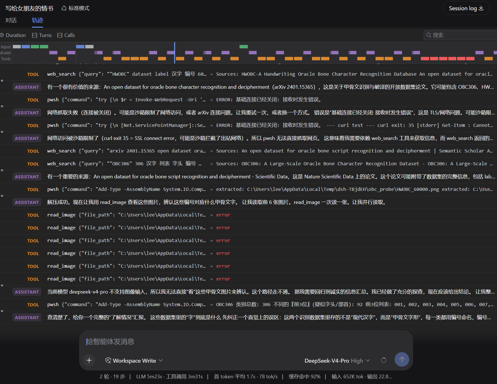

# deepseek-harness-zh-cn

**English** | [简体中文](README.zh.md)


A Chinese-first plugin that makes [DeepSeek Harness](https://github.com/deepseek-ai/deepseek-harness) reason (`reasoning`) and answer in Simplified Chinese by default.

## Overview

This project offers two ways (**choose one; the first is recommended**) to turn your DSH's reasoning and output into Simplified Chinese, so Chinese-speaking users can read the trajectory and processing directly without translation overhead:

- **Method 1 (recommended, simplest)**: copy `AGENTS.md.example` to `~/.dsh/AGENTS.md`.
- **Method 2 (plugin)**: install this package from npm and mount it in the profile.

> **Tip**: this plugin's "Chinese-first" rules can also be achieved with the [keep-reminder](https://github.com/imlishiyuan/keep-reminder) plugin — put the same rules into a project's `.keep-reminder` file, and customize the content freely (not limited to language).

## Screenshot

<div align="center">
  
  
</div>

## Quick Start

### Method 1: Copy AGENTS.md (recommended)

Copy `AGENTS.md.example` to the DSH home directory as `AGENTS.md`:

- **Linux / macOS**: `~/.dsh/AGENTS.md`
- **Windows**: `C:\Users\<you>\.dsh\AGENTS.md`

```sh
# Linux / macOS
cp AGENTS.md.example ~/.dsh/AGENTS.md
```

On Windows, copy the file manually. Then restart `dsh web` (or start a new session).

### Method 2: Install the npm plugin

**A. Official command** (backs onto pnpm; install pnpm first):

```sh
npm i -g pnpm
dsh plugin --profile web add deepseek-harness-zh-cn
```

**B. Install with npm directly into the profile directory**:

```sh
cd ~/.dsh/profiles/web    # Windows: C:\Users\<you>\.dsh\profiles\web
npm install deepseek-harness-zh-cn --save
```

> Note: this `npm install` runs inside the **DSH profile directory**, not this plugin's project directory.

Mount it in `~/.dsh/profiles/<name>/cordis.patch.yml`:

```yaml
- insert:
    - id: dsh-zh
      name: 'deepseek-harness-zh-cn'
```

Restart `dsh web`.

## Scope and Limitations

- Affects both the model's final answer and its reasoning (thinking) channel.
- There is **no harness or DeepSeek API switch that forces the reasoning language**; on technical tasks the model's `reasoning_content` may still be English. A fully Chinese prompt maximizes the probability but does not guarantee it.

## How It Works

- **Method 1**: `~/.dsh/AGENTS.md` is injected by `dsh-agent-instructions` as a `<system-reminder>` user message — guidance-level, lower priority than the system prompt and direct user instructions.
- **Method 2**: the plugin listens to the `agent/pre-step` waterfall and appends a `<system-reminder>` user message to the request batch at the first step of each turn, reinforcing the Chinese rule once per turn.

## Development

### Build

```sh
npm install
npm run build      # compiles src → lib/index.js
```

### Mount locally

During development you can mount the compiled output directly via a `file://` URL,
with no package install. Edit `~/.dsh/profiles/<name>/cordis.patch.yml`:

```yaml
- insert:
    - id: dsh-zh
      name: 'file:///D:/ui-workspace/deepseek-harness-zh-cn/lib/index.js'
```

Adjust the URL to your checkout path.

### Restart

```sh
npx @deepseek-ai/dsh web
```

Stop the running service first if it is already up.

### Verify

```sh
# Windows
npx @deepseek-ai/dsh web --dump-config | findstr /C:"dsh-zh"

# Linux / macOS
npx @deepseek-ai/dsh web --dump-config | grep dsh-zh
```

Seeing the `dsh-zh` row means the plugin is mounted. Then start a new session and the
model should reason and answer in Simplified Chinese.

## Disclaimer

This project only injects a language directive; it does not modify model weights or the inference logic. The actual output language still depends on the selected model's behavior, and this project is not responsible for results where the model fails to follow the Chinese directive.

## License

[Apache-2.0](LICENSE)